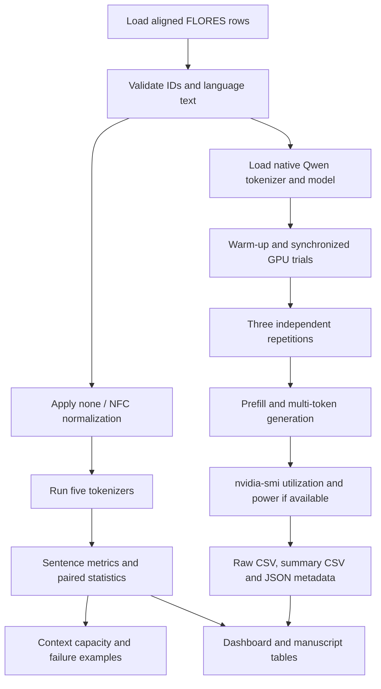

# The Token Tax: Measuring Tokenizer Inefficiency and Inference Cost for Indian Languages

**Authors:** To be completed  
**Institution:** To be completed  
**Version:** Research manuscript scaffold — replace all pending fields after the final local run  
**Evidence policy:** No unmeasured result is presented as a finding. All numeric result tables below are intentionally marked pending until generated artifacts are inspected.

## Abstract

Tokenization determines how much of a language-model context window a text occupies and how many input tokens an inference system must process. This study evaluates tokenization efficiency for aligned English, Hindi, Kannada, Tamil and Telugu sentences, and investigates the associated inference cost using a compatible native tokenizer–model pair. At least five tokenizer families are compared using sentence-level token counts, fertility, normalization sensitivity and fixed-context capacity. A GPU experiment measures prefill latency, generation latency, throughput and memory under controlled sequence lengths and repeated runs; GPU utilization and board-power energy are reported only when device telemetry is available. We distinguish tokenizer-only comparisons from model-native system measurements to avoid attributing architecture differences to tokenization alone. The final abstract must be completed with the actual dataset size, tokenizer/model revisions, measured effects and confidence intervals after the reproducible run is complete.

**Keywords:** multilingual NLP, Indic languages, subword tokenization, tokenizer fertility, FLORES-200, inference latency, GPU memory, context efficiency.

## 1. Introduction

Large language models commonly meter context and inference in tokens rather than characters or words. When a tokenizer segments languages unevenly, equivalent semantic content can occupy different fractions of a context window and require different amounts of prefill computation. This is particularly relevant for languages whose scripts and morphology may be underrepresented in tokenizer training data.

This project studies English, Hindi, Kannada, Tamil and Telugu using aligned parallel sentences. The work separates two questions: (1) how tokenizer families represent the same text, and (2) how a compatible pretrained model processes its own tokenizer's representations on a GPU. These are related but not interchangeable. A comparison between different pretrained model families is a system comparison, not a causal experiment isolating tokenizer choice.

### 1.1 Research questions

- **RQ1:** How do token counts and token fertility differ across the five languages and the selected tokenizer families on aligned sentences?
- **RQ2:** How much do Unicode NFC normalization and sentence length affect token counts?
- **RQ3:** How does language-dependent token count relate to fixed-context sentence capacity?
- **RQ4:** For a native tokenizer–model pair, how do input length and batch size affect prefill latency, generation latency, throughput and GPU memory?
- **RQ5:** When reliable device telemetry is available, what utilization and estimated GPU-board energy accompany multi-token generation?

### 1.2 Hypotheses (to be tested, not assumed)

- **H1:** Token fertility differs by language and tokenizer family; the magnitude and ordering are empirical questions.
- **H2:** NFC normalization changes tokenization for at least some text/tokenizer combinations, but the direction and size are not assumed.
- **H3:** Longer input sequences increase prefill work and memory use, subject to architecture and implementation.
- **H4:** Differences in token count translate into differences in native-model inference cost, but model architecture and runtime effects may confound cross-model comparisons.

## 2. Related Work

The final literature review should cite primary sources and the exact versions used. At minimum, cover:

1. Subword segmentation and byte-pair encoding (BPE), WordPiece and SentencePiece.
2. Multilingual pretrained models and tokenizer vocabulary allocation.
3. FLORES-200 and the NLLB evaluation/data pipeline.
4. Transformer autoregressive inference, prefill/decode separation and KV caching.
5. GPU measurement methodology, synchronization and measurement noise.

Do not cite a model card as evidence for a general linguistic claim. Record access dates and use the actual model/dataset licences. Add the verified bibliography in `paper/references.bib`.

## 3. Dataset, Models and Experimental Design

### 3.1 Dataset

The configured dataset is the consolidated FLORES-200 Parquet mirror `yash9439/flores200`, using the `dev` split and the aligned columns `eng_Latn`, `hin_Deva`, `kan_Knda`, `tam_Taml` and `tel_Telu`. The loader obtains all language strings from the same row, preserving sentence alignment by construction. The experiment configuration currently requests up to 997 parallel rows; the actual number loaded must be read from the run metadata.

FLORES-200 is associated with the NLLB research work. The mirror's provenance and the original dataset's CC-BY-SA 4.0 obligations must be verified and attributed before redistribution or publication. The repository does not redistribute corpus dumps.

| Dataset field | Value |
|---|---|
| Dataset | FLORES-200 consolidated Parquet mirror |
| Configured source | `yash9439/flores200` |
| Split | `dev` |
| Languages | English, Hindi, Kannada, Tamil, Telugu |
| Configured maximum | 997 aligned rows |
| Actual rows | **PENDING: read from run metadata** |
| Dataset revision | **PENDING: immutable revision from metadata** |
| Licence/provenance | Verify mirror metadata and cite original FLORES/NLLB source |

### 3.2 Tokenizers

The configured candidates are GPT-2 BPE (`gpt2`), multilingual BERT WordPiece (`bert-base-multilingual-cased`), XLM-R SentencePiece (`xlm-roberta-base`), Qwen2.5-0.5B tokenizer (`Qwen/Qwen2.5-0.5B`) and IndicBERTv2 (`ai4bharat/IndicBERTv2-MLM-only`). The exact resolved commit hashes are stored per tokenizer in tokenizer CSV rows. Before publication, verify each model card, tokenizer licence, vocabulary and language coverage; do not infer that a model's training objective makes it directly comparable to a causal language model.

### 3.3 GPU model

The GPU benchmark uses Qwen2.5-0.5B with its native tokenizer. The model revision is resolved and recorded. The benchmark uses FP16 by default and measures a native model path. No foreign tokenizer is injected into this model. Report model architecture, parameter count, attention/KV-head count, exact revision, model licence and precision from the actual metadata.

### 3.4 Experimental factors and ablations

- Languages: five configured language columns.
- Tokenizers: five configured candidates.
- Normalization: original text (`none`) and Unicode NFC.
- Length groups: short, medium and long, based on whitespace-word count as implemented.
- GPU input lengths: configured 128, 256 and 512 tokens.
- GPU batch size: configured batch size 1 for the 6 GB target device.
- Repetitions: three independent timed repetitions per GPU configuration.
- Within-repetition trials: configured warm-up and timed trial counts; report these separately from repetition count.
- Generation: fixed multi-token generation target (configured 16 tokens); record actual generated tokens if the implementation changes.

### 3.5 Pipeline



## 4. Metrics and Statistical Methods

### 4.1 Tokenizer metrics

For each sentence (s), tokenizer (t), language (l) and normalization form (n), record token count (T_{t,l,n,s}), character count and whitespace-word count. Report:

- Mean and median tokens per sentence.
- Tokens per character and tokens per whitespace-delimited word.
- Indic-to-English paired token-count ratio and paired difference by sentence ID.
- Length-bucket summaries.
- Context-window capacity: number of complete aligned sentences that fit within the configured token budget, and the difference relative to English.

The whitespace-word measure is a descriptive denominator, not a linguistically universal word segmentation. It must not be interpreted as a language-independent morphological unit.

### 4.2 Paired inference

Use paired sentence IDs when comparing each Indic language with English. Report paired mean differences/ratios and bootstrap confidence intervals, preserving the pairing. Tokenizer counts are deterministic for fixed text and tokenizer revision; random seeds are not meaningful repetitions for these counts.

### 4.3 GPU metrics

- Prefill latency: synchronized wall-clock duration for the forward pass with KV cache.
- Generation latency: synchronized end-to-end duration for generating the configured number of new tokens.
- Throughput: actual generated tokens divided by measured generation duration; state whether this is per sequence or across the batch.
- Memory: peak allocated and peak reserved CUDA memory, plus baseline model allocation and delta.
- KV cache: theoretical architecture-derived estimate using layer count, KV heads, head dimension, sequence length, batch size and element size. This is an estimate, not a direct cache allocation measurement.
- Repetitions: report each repetition ID and repetition-level mean; across repetitions report mean, sample standard deviation and two-sided 95% Student-t confidence interval.
- Utilization and power: sample `nvidia-smi` during the timed window. Missing/N/A telemetry is null/unavailable, never zero.
- Energy: if power samples are reliable, estimate board energy from mean sampled watts multiplied by the measured wall duration. Divide by actual generated tokens for estimated joules/token. This is GPU-board energy, not whole-system energy, and is not a direct energy-meter reading.

Three repetitions provide limited statistical precision. Confidence intervals must be interpreted accordingly. p95 computed from a small number of within-repetition trials is descriptive and should not be presented as a stable tail-latency guarantee.

## 5. Hardware and Software Environment

Populate this table from the local run metadata and the user's device diagnostics. Do not copy an assumed environment into the final manuscript.

| Component | Recorded value |
|---|---|
| Operating system | **PENDING: run metadata** |
| CPU | **PENDING** |
| GPU model | **PENDING: run metadata** |
| GPU VRAM | **PENDING: run metadata** |
| NVIDIA driver | **PENDING** |
| CUDA-enabled PyTorch build | **PENDING: run metadata** |
| Python | **PENDING: run metadata** |
| PyTorch / Transformers / Tokenizers | **PENDING: run metadata** |
| Git commit | **PENDING: run metadata** |
| Model revision | **PENDING: GPU metadata** |
| Dataset revision | **PENDING: run metadata** |

## 6. Results

**This section must be populated from the final local run artifacts. The existing pilot CSV is a single-run baseline and is not evidence for the three-repetition protocol.**

### 6.1 Main tokenizer comparison

| Tokenizer | English mean | Hindi mean | Kannada mean | Tamil mean | Telugu mean | Paired CI / effect |
|---|---:|---:|---:|---:|---:|---|
| GPT-2 BPE | Pending | Pending | Pending | Pending | Pending | Pending |
| mBERT WordPiece | Pending | Pending | Pending | Pending | Pending | Pending |
| XLM-R SentencePiece | Pending | Pending | Pending | Pending | Pending | Pending |
| Qwen2.5 tokenizer | Pending | Pending | Pending | Pending | Pending | Pending |
| IndicBERTv2 | Pending | Pending | Pending | Pending | Pending | Pending |

### 6.2 GPU performance

| Language | Input tokens | Batch | Repetitions | Prefill mean ± SD | Generation mean ± SD | Peak memory | Utilization / energy |
|---|---:|---:|---:|---:|---:|---:|---|
| Pending | Pending | Pending | Pending | Pending | Pending | Pending | Pending |

### 6.3 Normalization ablation

| Tokenizer | Language | none mean tokens | NFC mean tokens | Difference | Relative change |
|---|---|---:|---:|---:|---:|
| Pending | Pending | Pending | Pending | Pending | Pending |

### 6.4 Repeated-run statistics

Report the raw repetition-level measurements and summary mean, sample standard deviation and 95% CI for every language/sequence-length/batch configuration. Include the number of within-repetition timed trials and any failed/OOM configuration.

### 6.5 Figures

Generate figures from committed run artifacts:
1. Mean token count by tokenizer and language.
2. Paired Indic/English fertility ratios with confidence intervals.
3. none-vs-NFC token-count change.
4. Prefill latency versus input sequence length.
5. Multi-token generation latency and generated tokens/second.
6. Repetition means with standard deviation/95% CI.
7. GPU utilization and estimated energy per generated token where telemetry exists.

## 7. Failure Analysis

The failure analysis should classify, preserve and manually inspect examples rather than silently discard them:

- High-fertility outliers by tokenizer/language, with paired English baseline.
- Unicode normalization differences (original code points versus NFC and token-count change).
- Empty or whitespace-only text and non-text values.
- Unsupported/unknown-token behavior where the tokenizer exposes it.
- Truncation events with original token count, configured maximum and truncated count. Do not infer truncation from tokenizer-only rows if truncation was not applied.
- GPU out-of-memory and CUDA/runtime failures, including model, language, sequence length, batch, precision and error message.
- Misalignment or missing sentence IDs, which should fail validation before analysis.

Current high-fertility CSV output is a first diagnostic, not a complete failure taxonomy. GPU OOM events and truncation require explicit instrumentation and should be reported as unavailable if they were not captured.

## 8. Discussion

Answer each research question using measured estimates and uncertainty. Explain whether token fertility varies by language and tokenizer, whether normalization has a practically meaningful effect, and whether context capacity changes. Interpret GPU results only for the native model/tokenizer pair tested. Discuss how token count, model architecture, memory bandwidth, precision, batch size, padding and GPU scheduling contribute to observed latency.

Do not claim that an observed difference is caused solely by the tokenizer when comparing different pretrained model families. Relate results to prior work only after the literature review has been completed and cited.

## 9. Limitations and Threats to Validity

1. Five languages do not represent all Indic languages, dialects or domains.
2. FLORES sentences are translated evaluation text and may not represent conversational, educational or code-mixed use.
3. Sentence-level token ratios do not measure translation quality or semantic equivalence.
4. Whitespace-word counts are not comparable morphological word counts across scripts.
5. Tokenizer comparisons depend on exact revisions, normalization behavior and special-token policy.
6. GPU timings depend on device thermals, background applications, driver/runtime versions and sampling overhead.
7. A 0.5B native model does not establish performance for larger LLMs.
8. Cross-model GPU comparisons are confounded by architecture and implementation.
9. Three repetitions give wide confidence intervals; further repetitions and independent devices would improve reliability.
10. Windows WDDM may expose incomplete power or utilization telemetry. Missing telemetry limits energy conclusions.
11. The theoretical KV-cache estimate depends on model configuration and precision and is not a direct memory measurement.
12. The dataset mirror's provenance and licence must be checked against the original distribution.

## 10. Conclusion

Complete this section only after results are finalized. Summarize the measured language/tokenizer differences, the normalization ablation, the native-model GPU findings and the limits of the evidence. Avoid universal claims from one model and one laptop GPU.

## 11. Reproducibility Appendix

### Windows commands

```powershell
git clone https://github.com/omtejas/token-tax-indic.git
cd token-tax-indic
Set-ExecutionPolicy -Scope Process -ExecutionPolicy Bypass
.\setup_windows.ps1
.\run_full_study.ps1
.\run_dashboard.ps1
```

Individual stages:

```powershell
.\.venv\Scripts\python.exe -m token_tax.cli tokenize --config configs\experiment.yaml
.\.venv\Scripts\python.exe -m token_tax.cli gpu-benchmark --config configs\experiment.yaml --model-config configs\model.yaml
.\.venv\Scripts\python.exe -m token_tax.cli failure-analysis --input <tokenizer_metrics.csv> --output results\failure_examples.csv --top-n 20
python -m pytest
```

Record the Git commit, YAML configs, exact dataset/model/tokenizer revisions, raw CSVs, summary CSVs, JSON metadata, environment and command output with the final submission. Preserve raw artifacts separately from derived plots and tables.
